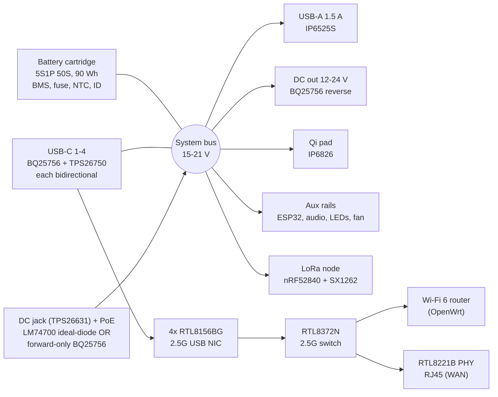

# Battery Bank

An open-hardware travel power bank that is also a 2.5G travel router, a flashlight, a Bluetooth speakerphone and an off-grid Meshtastic LoRa node. Four USB-C ports each charge and supply power while also giving a connected laptop 2.5 Gb/s Ethernet. A swappable 90 Wh battery cartridge keeps it under the 100 Wh airline limit. It is designed in KiCad 10, with the schematic generated from Python, and built at JLCPCB (PCB and assembly).

> ## DESIGN IN PROGRESS
> **First-pass schematic complete; adversarial review round 1 in progress. Not laid out or built. Do not build from these files yet.**
> Main board: 16 sheets, 1,115 parts, 159 BOM lines; design check 0 errors, 3 warnings (consigned RJ45 PoE MagJack, router module, PoE transformer); KiCad ERC 21 cosmetic library-mismatch warnings. Cartridge: 60 parts, 0 errors.
> Review round 1 uses three Claude reviewers and an independent OpenAI Codex gpt-6.2-astra reviewer; reports go to `hardware/review/`. Numbers, parts and decisions can still change.

## Features

**Power**
- Swappable battery cartridge: 5S1P Samsung 50S, 90 Wh, with cells, BQ7791500 protector, STS2250 fuse, NTCs and BQ34Z100-G1 gauge inside the cartridge (a separate PCB and KiCad project). A removed cartridge hibernates with its FETs off.
- Four USB-C ports, each with its own bidirectional TI BQ25756 power stage and TPS26750 PD controller. Any port can be an input or an output.
- 100 W cap per port, with 28 V EPR supported at reduced current. OnePlus phones charge via PPS on USB-C.
- One USB-A output, limited to 1.5 A.
- Pass-through inputs: any USB-C port, a DC barrel jack (TPS26631 eFuse + LM74700 ideal-diode ORing), and PoE (802.3bt Type 3, TPS2373-4 + LM5155 flyback). DC and PoE share one forward-only BQ25756 stage.
- Everything is meant to work at the same time, from battery or from pass-through power.
- Firmware power allocator that shares the budget by priority and re-advertises lower PD offers when over budget.
- Slow-charge toggles (bank, per port, Qi pad) and a physical SLOW switch.
- Fan plus aluminum case as heatsink, with NTC-driven throttling.

**Networking**
- 2.5G Ethernet on all four USB-C ports (RTL8156BG per port), joined by an RTL8372N switch.
- Wi-Fi 6 OpenWrt travel-router module on the switch, with an RJ45 (RTL8221B PHY) as WAN.
- Power-gated Ethernet and router blocks to save battery.

**Wireless**
- ESP32-WROOM-32UE (U.FL antenna): control, Wi-Fi, Bluetooth, phone app.
- Meshtastic LoRa node (nRF52840 + SX1262) that can stay on as a relay when the rest of the bank is off.
- NFC tap-to-pair.
- Qi wireless charging pad.

**Audio and light**
- Bluetooth speaker and speakerphone (MAX98357A amp, PDM MEMS mic).
- Flashlight driver AL8860, glow LEDs SK6812MINI-E.
- Flashlight (XP-G3 LED, AL8860 driver) with low / med / high / strobe / SOS.
- Red night LED.
- Addressable RGB glow LEDs for status and attention.

**Travel extras**
- DC barrel output (12-24 V, app-selected, off by default).
- Per-port power meter and USB-C cable tester in the app.
- Aux rails: ten TPS62933P bucks (six system rails plus one 0.95 V per RTL8156BG) and a TPS56A37 10 A buck for the switch core.
- Alarm clock firmware: sunrise ramp, wake and sleep sounds.
- Solar / DC input with MPPT, microSD slot, tripod mount and lantern mode.
- Low-current mode, charge limit and health stats, left-behind alert.

**Open and debuggable**
- Open ESP32 firmware (license TBD), OpenWrt on the router, Meshtastic on the LoRa node.
- Test points on every rail, solder-jumper isolation of each block, programming pads, status LEDs. See [docs/design-rules.md](docs/design-rules.md).

## Key specs

| Item | Value |
|---|---|
| Battery | 5S1P Samsung 50S 21700, 90 Wh, 15.0-21.0 V, swappable cartridge |
| Battery-only output | 125 W guaranteed (3:1 on cell current: 8.3 A x 15 V at empty); firmware limit 8.0 A |
| USB-C ports | 4, each up to 100 W; 28 V EPR at reduced current |
| USB-A | 1.5 A (VOOC dropped; connector rating) |
| Ethernet | 2.5G on all four USB-C ports, plus RJ45 (WAN) |
| Pass-through inputs | USB-C (any port), DC barrel (40 W max at 24 V), PoE 802.3bt Type 3 (~51 W) |
| Qi pad | 5 W |
| Flashlight | ~1.5 W |
| Speaker | ~1 W average |
| DC output | 12-24 V, 1.67 A max jack limit (40 W at 24 V, 20 W at 12 V) |
| Runtime, everything on | ~40 min from 90 Wh at the 125 W "everything on" budget |
| Internal dissipation, everything on | roughly 12-15 W |
| PCB | 6 layers, ENIG, 2 oz outer copper, JLCPCB standard PCBA |

Per-block figures are 3:1-derated maxima. See [docs/power-budget.md](docs/power-budget.md) for the full "everything on" profile.

## Safety design

- **3:1 safety buffer on current, power and thermal capacity.** Every part that carries current or dissipates power is rated for at least 3x its worst-case operating current or power. This covers cells, inductors, MOSFETs, diodes, resistors, connectors, copper and vias, fuses, regulators, and thermal margin (Tj at least 40 C below max). That is why the pack delivers 125 W (not 187 W), the Qi pad is 5 W and the flashlight is ~1.5 W.
- **3:1 does not apply to voltage.** Voltage uses standard derating: ceramic caps at 2x, MOSFET V_DS at 1.5x plus ringing, diodes at 1.5x, TVS and IC pins within their recommended range.
- **Documented exceptions** where an interface standard rules out 3:1: USB-C and USB-A contacts, PoE pairs and magnetics, and IC-internal switches. Each has a stated mitigation (see design rules section 1.4).
- **Safety is enforced in hardware,** so open firmware cannot make the pack unsafe:
  - BMS in the cartridge (over/under-voltage, over-current, temperature)
  - fuses
  - charger current ceilings set by resistors
  - an independent over-temperature cutoff
- **Airline compliance:** each cartridge is 90 Wh, under the 100 Wh no-approval limit, and is labeled with its Wh rating. Check your airline's rules before flying.
- **Review gate:** layout starts only after the adversarial design review has no open critical or major findings.

## Architecture



The ESP32 is the always-on controller. The router module is power-gated and boots only when router mode is on. Battery loads and pass-through inputs share one node, so input power serves the loads first and the surplus charges the pack.

## Repository layout

```text
.
├── plan.md                  Living design plan: requirements, decisions D1-D12, parts, risks
├── docs/
│   ├── design-rules.md      3:1 current/power buffer, voltage derating, debuggability rules
│   ├── power-budget.md      "Everything on" power profile and allocator priorities
│   ├── chip-metadata.md     Per-chip pin, supply and stock notes
│   ├── jlcpcb-rules.md      JLCPCB stackup, geometry and assembly rules
│   └── datasheets/          Datasheet PDFs for the main chips
└── hardware/
    ├── gen/                 Python schematic generator
    │   ├── bb.py            Design helpers
    │   ├── kicad_writer.py  Writes KiCad schematic files
    │   ├── symlib.py        Symbol library access
    │   ├── generics.py      Generic parts (passives, connectors)
    │   ├── sexp.py          S-expression reader/writer
    │   └── passives.json    Chosen passives (output of pick_passives.py)
    ├── checks/
    │   └── check.py         Design checker (derating, 3:1, open pins, single-pin nets, LCSC numbers)
    ├── gen/blocks/          One Python file per schematic block (usbc_port, power_input, poe, ...)
    ├── kicad/               Generated main-board project, ERC report, design_check.txt, BOM, PDF
    ├── kicad_cartridge/     Generated battery-cartridge project
    ├── review/              Adversarial review reports
    ├── mechanical/          mech_spec.json (enclosure, boards, connector positions)
    ├── tools/
    │   ├── jlc.py           JLCPCB parts-library lookup (with local cache)
    │   └── pick_passives.py Picks passives (Basic parts preferred, voltage derating)
    └── lib/                 LCSC/EasyEDA symbols, footprints and 3D models (via easyeda2kicad)
```

## Regenerate and look up parts

Requirements: [KiCad 10](https://kicad.org/download/) and Python 3. The tools use only the Python standard library and call the public JLCPCB parts search, so network access is needed.

```bash
# Look up a part in the JLCPCB library (results cached in hardware/tools/jlc_cache.json)
python hardware/tools/jlc.py "100nF 0402 50V"
python hardware/tools/jlc.py --code C1525

# Re-pick passives; writes hardware/gen/passives.json
python hardware/tools/pick_passives.py
```

Build the schematics (main board, then the battery cartridge):

```bash
python hardware/gen/build.py                      # writes hardware/kicad/
python hardware/gen/build.py --project cartridge  # writes hardware/kicad_cartridge/
```

Each build writes the KiCad project and schematics, `erc.rpt`, `design_check.txt`, `bom_jlcpcb.csv` and a PDF of the schematic. Open the `.kicad_pro` file in KiCad 10.

## Manufacturing target

JLCPCB, standard PCBA: 6-layer, impedance-controlled, 1.6 mm, ENIG, 2 oz outer copper, SMT on the top side where possible. Basic parts are preferred for passives, since each unique Extended part adds a setup fee. Details and design-rule values are in [docs/jlcpcb-rules.md](docs/jlcpcb-rules.md).

## Documentation

- [plan.md](plan.md): requirements, decisions, architecture, parts and risks. Some entries predate the latest changes (voltage vs. current derating, 100 W per-port cap, four bidirectional USB-C stages).
- [docs/](docs/): design rules, power budget, chip metadata, JLCPCB rules, and the project documentation site (GitHub Pages).
- `docs/datasheets/INDEX.md`: datasheet index (being written; the PDFs are in [docs/datasheets/](docs/datasheets/)).

## Roadmap and open decisions

- Read the RTL8372N datasheet: PHY integration and SerDes modes. Pick a router module that accepts a 2.5G/10G SerDes link.
- Confirm the router module vendor and sourcing (probably not JLCPCB-stocked; module board or consignment).
- Source a PoE-rated, 2.5GBASE-T RJ45 and the isolated PoE flyback (controller and transformer).
- TPS26750 has low JLCPCB stock (4 needed per board). Verify stock and line up alternatives.
- Resolve pass-through charge termination: the loads sit on the battery node and can mask charge current.
- Test the USB-C data-role swap with phones (needed for Ethernet).
- Prototype Bluetooth audio with Wi-Fi on one ESP32; add an audio SoC if call quality is poor.
- Plan antennas and RF windows for Wi-Fi 6, ESP32, nRF52840 and LoRa in a metal case.
- Finish adversarial review round 1 (three Claude reviewers plus an independent Codex reviewer), repair, and repeat until no critical or major findings remain; then start layout.
- Close the open VERIFY items in the generator code (PoE flyback values, IP6826 crystal, IP6525S enable, TPS56A37 FB/MODE, RTL8156BG RSET, router module pinout).
- Update plan.md to match the latest decisions.

## License

TBD. The open-source hardware and firmware license has not been chosen yet.
