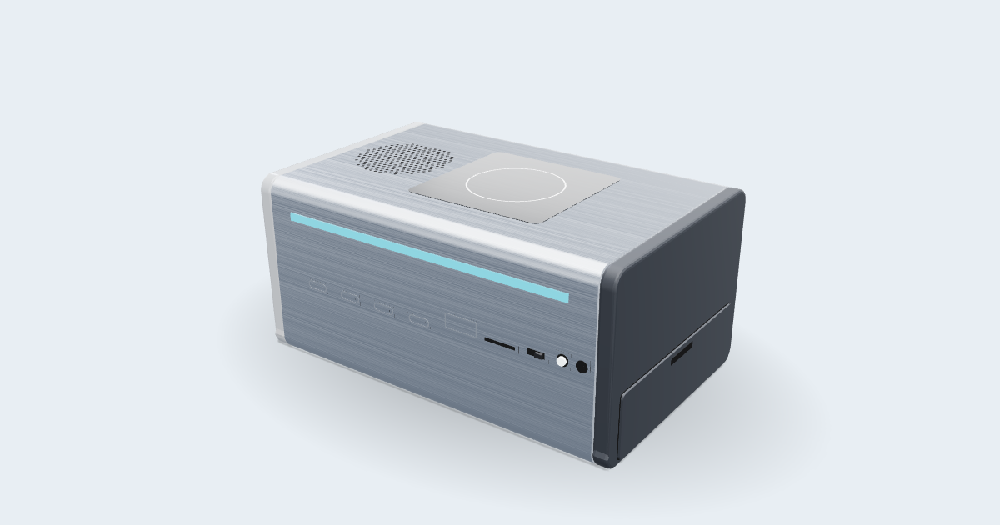
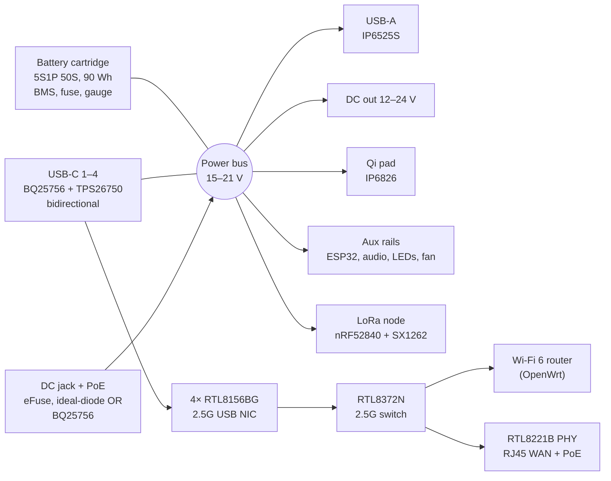

# Battery Bank Travel Router

[](https://monstercameron.github.io/Battery-Bank-Circuit-Design/)
[](hardware/review/round1_tracker.md)
[](https://kicad.org)
[](docs/jlcpcb-rules.md)

**One box instead of five.** This is an open-hardware travel power bank. It is also a 2.5G Wi-Fi 6 travel router, a flashlight, a Bluetooth/IP speakerphone and an off-grid Meshtastic LoRa node.

- **Four USB-C ports.** Each port charges or supplies up to 100 W. Each also gives the laptop on the other end 2.5 Gb/s Ethernet over the same cable.
- **Swappable battery.** The cartridge holds 90 Wh, under the 100 Wh airline limit.
- **Pass-through power.** USB-C, a DC barrel jack or PoE can power everything at once while the pack charges.

[](https://monstercameron.github.io/Battery-Bank-Circuit-Design/)

**[Project site and interactive 3D model →](https://monstercameron.github.io/Battery-Bank-Circuit-Design/)** · [Dev log](docs/devlog.md) · [Review tracker](hardware/review/round1_tracker.md)

> [!WARNING]
> **Design in progress. Do not build from these files.** The schematic is generated and passes its checks. It is now in adversarial review round 1, and fixes for its critical findings are still being made. Nothing has been laid out, built or tested.

## Status

| Stage | State |
|---|---|
| Requirements and architecture | Done ([plan.md](plan.md); partly superseded by the review) |
| Schematic generator | Done: Python → KiCad 10, 19 sheets, ~1,180 parts across two boards plus a cartridge |
| Automated design check | 0 errors at the last full build. The build fails on any KiCad ERC error, a derating or 3:1 violation, an IC pin over its abs-max, a net crossing boards without a connector, or out-of-stock parts |
| Adversarial review, round 1 | Four independent reviewers (three Claude, one OpenAI Codex `gpt-6.2-astra`), about 170 findings in total. Every critical high-speed and control finding is fixed. Power, PoE, cartridge and logic fixes are in progress |
| Next architecture change | Separate pack charging from the system bus: one dedicated, current-limited pack charger and a controlled insertion path (Codex X-2, X-3) |
| Review round 2 → layout → prototype | Not started |

Each change is recorded in the [dev log](docs/devlog.md). [CONTINUE.md](CONTINUE.md) says exactly where the work paused.

## Features

**Power**
- **Swappable 90 Wh cartridge:** 5S1P Samsung INR21700-50S cells. Inside: BQ7791500 protector, fuse, NTCs and BQ34Z100-G1 gauge. The cartridge is its own PCB and KiCad project.
- **Four bidirectional USB-C ports.** Each has a TI BQ25756 buck-boost stage, a TPS26750 PD controller and TPD4S480 protection. Any port can be an input or an output, sourcing up to 100 W (SPR). Higher-voltage EPR sources are accepted as inputs.
- **USB-A output** (IP6525S) with a 1.5 A target.
- **Pass-through inputs:**
  - Any USB-C port.
  - DC barrel 12–24 V: TPS26631 eFuse with LM74700 ideal-diode ORing.
  - PoE 802.3bt Class 6: TPS2373-4 with an isolated LM5155 flyback.
- **DC barrel output:** 12–24 V, app-selected, off by default.
- **Everything at once:** designed to run every function at the same time, from the battery or from pass-through power. A firmware power allocator shares the budget by priority.
- **Cooling:** a fan plus the aluminium case as heatsink, with NTC-driven throttling and slow-charge toggles.

**Networking**
- **2.5G Ethernet on all four USB-C ports.** Each port has an RTL8156BG, and all four join an RTL8372N 2.5G switch.
- **Router:** a Wi-Fi 6 OpenWrt travel-router module on the switch, with an RJ45 WAN (RTL8221B PHY). The RJ45 also accepts PoE.
- **Power gating:** the network and router blocks are power-gated to save battery.

**Wireless, audio and light**
- **ESP32-WROOM-32UE:** the always-on controller, with Wi-Fi/Bluetooth phone app, NFC tap-to-pair and Qi 5 W pad.
- **Meshtastic LoRa node:** nRF52840 + SX1262. It can stay on as a relay with the rest of the bank off.
- **Speakerphone:** Bluetooth/IP, with a MAX98357A amp and PDM MEMS mics.
- **Flashlight:** XP-G3 with an AL8860 driver: low/med/high/strobe/SOS, plus a red night LED and an SK6812 attention-glow strip.

**Travel extras.** Port power meter and cable tester, alarm clock (sunrise ramp), microSD, solar input, tripod mount and lantern mode, and a left-behind alert.

## Design rules that drive everything

- **3:1 margin on current, power and thermal capacity.** Every part that carries current or dissipates power is rated for at least 3× its worst-case operating value:
  - cells, inductors, FETs and resistors
  - connectors and board-to-board pins
  - copper
  - thermal margin
  That is why the battery-only budget targets about 125 W rather than 187 W, and why the Qi pad is 5 W.
- **Voltage uses standard derating, not 3:1.** MLCCs are rated ≥2×; FETs and diodes ≥1.5×. Every IC pin is checked against its datasheet abs-max.
- **Documented exceptions** only where a standard rules out 3:1: USB-C/USB-A contacts, PoE pairs and IC-internal switches. See [design-rules.md](docs/design-rules.md).
- **Safety must not depend on firmware.** The cartridge BMS, fuses and resistor-set limits protect the pack even with custom firmware. The review found that charger registers can override some pin-set limits (Codex X-12). Independent hardware ceilings are being added.
- **Debuggable by design:** test points on every rail, isolation links per block, programming pads and status LEDs.
- **JLCPCB-friendly.** Parts are chosen from the JLC/LCSC library with Basic parts preferred, and the build checks stock against 5× the per-board quantity. See [JLCPCB rules](docs/jlcpcb-rules.md).
- **Review gate:** layout starts only when a review round finds no open critical or major issues.

## Architecture



**Two boards in an extruded aluminium body.**
- **Board A (power):** USB-C stages, NICs, switch, MCU, inputs and aux rails.
- **Board B (logic):** PHY, RJ45, PoE, router, LoRa, audio, Qi and glow.
- **Interconnect:** the generator builds it automatically: a 48-pin low-speed/power header (power pins sized for 3:1) and a ground-shielded mezzanine carrying the four SerDes pairs.
- **Mechanical spec:** positions are in [mech_spec.json](hardware/mechanical/mech_spec.json). The site's 3D model is built from the same file.

**Changing next:** a separate system bus with a dedicated pack charger. Today, the chargers and loads share the battery node. The review showed that this cannot hold a single aggregate charge-current limit (Codex X-2), so pack charging is moving behind its own current-limited charger.

## Repository layout

```text
.
├── CONTINUE.md              Where the work paused and what comes next
├── plan.md                  Original living plan: requirements, decisions, parts, risks
├── docs/                    GitHub Pages site (Tailwind landing page + Jekyll reference pages)
│   ├── index.html           Landing page with the interactive three.js model
│   ├── devlog.md            Dated record of every design change
│   ├── design-rules.md      3:1 policy, voltage derating, debuggability rules
│   ├── power-budget.md      "Everything on" power profile and allocator priorities
│   ├── jlcpcb-rules.md      JLCPCB stackup, geometry and assembly rules
│   ├── chip-metadata.md     Per-chip pin, supply and stock notes
│   ├── assets/              3D model (device3d.js), mech spec copy, social card
│   └── datasheets/INDEX.md  Datasheet index with source URLs (PDFs are fetched locally, not committed)
└── hardware/
    ├── gen/                 Python schematic generator
    │   ├── build.py         Entry point: builds, checks, runs ERC, writes BOM, promotes on success
    │   ├── bb.py            Design helpers (R, C, L, FET, IC, TP, connectors, fields)
    │   ├── kicad_writer.py  KiCad 8/10 schematic writer
    │   └── blocks/          One file per block (usbc_port, power_input, poe, eth_switch, cartridge, ...)
    ├── checks/check.py      Design checker: derating, 3:1, pin abs-max, board crossings, open pins, stock
    ├── kicad/               Generated main project: schematics, ERC report, design check, BOM, PDF
    ├── kicad_cartridge/     Generated battery-cartridge project
    ├── review/              Review reports (round1_*.md), finding tracker, repair patch scripts
    ├── mechanical/          mech_spec.json: enclosure, boards, zones, connector positions
    ├── tools/               jlc.py (JLCPCB parts search), pick_passives.py, dsgrep.py, pdftxt.py
    └── lib/                 LCSC/EasyEDA symbols and footprints (via easyeda2kicad)
```

## Build the schematics

Requirements:
- [KiCad 10](https://kicad.org/download/); the build calls `kicad-cli` for ERC and the PDF.
- Python 3 (standard library only).
- Network access for JLCPCB part lookups.

```bash
# Main boards (A + B + interconnect) -> hardware/kicad/
PYTHONIOENCODING=utf-8 python hardware/gen/build.py --stock

# Battery cartridge -> hardware/kicad_cartridge/
PYTHONIOENCODING=utf-8 python hardware/gen/build.py --project cartridge

# Experiments: write somewhere else, or build a subset (goes to hardware/kicad_partial/)
python hardware/gen/build.py --out /tmp/bb_test
python hardware/gen/build.py --only usbc_port aux_power
```

**How the build writes its output:**
- **Staging first.** Every build writes to a `.staging` folder.
- **Promotion only on success.** The output folder is replaced only when the design check **and** KiCad ERC both report 0 errors. A failed build never overwrites a good one.
- **What a build produces:** schematics, `design_check.txt`, `erc.rpt`, `bom_jlcpcb.csv` and a schematic PDF.
- **Skipping ERC:** `BB_SKIP_ERC=1` skips it on machines without KiCad.

**Parts and datasheets:**

```bash
python hardware/tools/jlc.py "100nF 0402 50V"   # JLCPCB library search (cached)
python hardware/tools/jlc.py --code C1525
python hardware/tools/pick_passives.py         # regenerate hardware/gen/passives.json
python hardware/tools/dsgrep.py "VBUS_LV"      # search extracted datasheet text
```

## How the review loop works

1. **Review.** Each round, independent reviewers try to break the design: power/safety, high-speed, control/DFM, plus a Codex `gpt-6.2-astra` reviewer with no access to the others' reports. Reports go in [hardware/review/](hardware/review/).
2. **Track.** Every finding gets an ID (P-, H-, C-, X-) and a status in the [tracker](hardware/review/round1_tracker.md).
3. **Repair.** Fixes land in the generator blocks, never in the generated KiCad files. Repair agents each own separate files and must bring the build back to 0 errors.
4. **Strengthen the checker.** When a reviewer catches something the checker missed, the checker gains a rule. Examples: pin abs-max, board crossings, stock, computed resistor dissipation, ERC gating.
5. **Repeat** until a round finds no critical or major issues.

## Open questions

- **Realtek confirmations:** whether the capacitively coupled 2.5GBASE-T links between the PHYs work, the RTL8156BG RSET value, and access to the RTL8372N SDK image.
- **Configuration images:** the TPS26750 PD image (100 W SPR source, data-role swap so the NIC can enumerate), and a per-NIC MAC eFUSE step in production.
- **Router module:** final choice, pinout and supply.
- **Connectors:** board-to-board parts.
- **PoE:** MagJack and flyback transformer (consigned).
- **Sourcing:** TPS26750 stock (four per board).
- **RF:** antenna windows for Wi-Fi 6, ESP32, nRF52840 and LoRa in a metal case.

## License

TBD. The open-source hardware and firmware licences have not been chosen yet.
