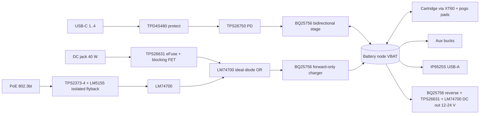
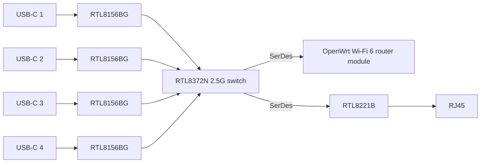
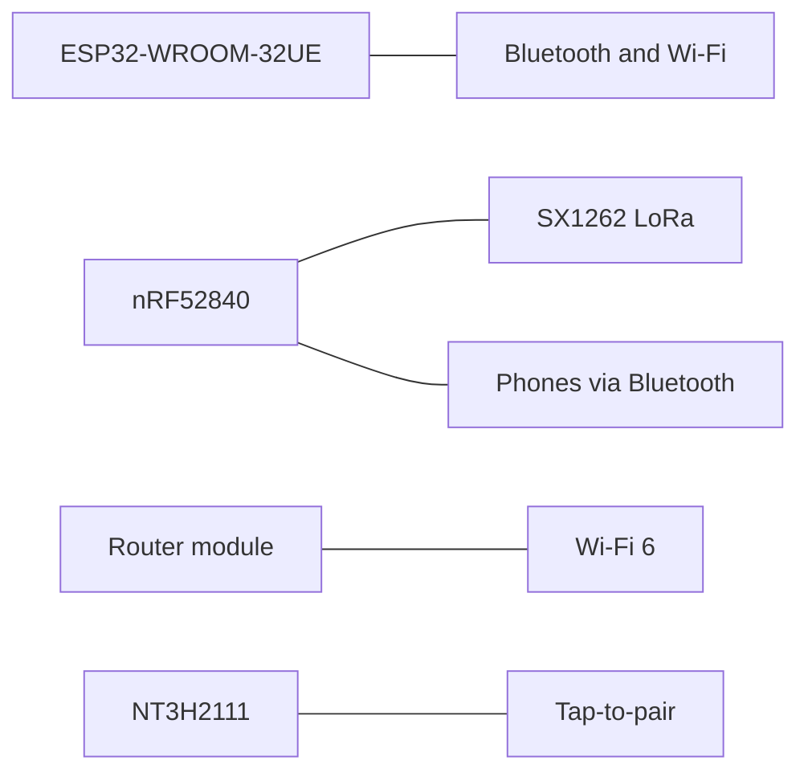
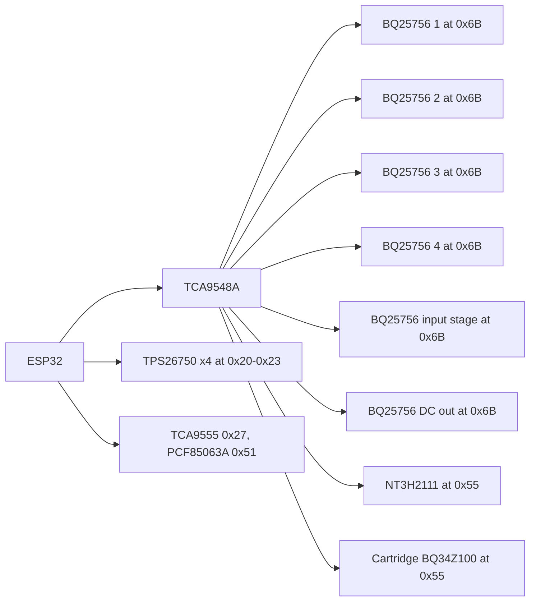

# Architecture

## Power path

Inputs feed power stages, which meet at one battery node (the system bus). Outputs draw from that node, so input power serves the loads first and any surplus charges the pack.

- Each USB-C port has its own BQ25756, so a charger on any port charges the bank directly and any port can also source power.
- The DC jack path is TVS, a TPS26631 eFuse with a back-to-back blocking FET (over-voltage cutoff 24.3 V, current limit 1.65 A), then an LM74700 ideal-diode controller onto VIN_AUX. The PoE path (TPS2373-4 PD, LM5155 isolated flyback) goes through its own LM74700 onto the same VIN_AUX. The higher-voltage source wins. VIN_AUX feeds one forward-only BQ25756 stage.
- The DC output is a reverse-mode BQ25756 (charging disabled in hardware, default off) followed by a TPS26631 eFuse and an LM74700, so nothing plugged into the jack can back-feed the converter.
- The cartridge is a separate PCB and KiCad project (`hardware/kicad_cartridge/`): BQ7791500 protector with two pairs of back-to-back NTMFS5C628NL FETs, an STS2250 fuse, a BQ34Z100-G1 gauge on a TLV70433 regulator, and an XT60PW connector. Its PRES pin is pulled up only through a loop the main board closes (pogo PRES_A to PRES_B), so a removed cartridge hibernates with its FETs off. The main board detects presence through the gauge on I2C mux channel 7.
- A firmware power allocator re-advertises PDOs when the budget is exceeded. See [power-budget.md](power-budget.html).

## Networking

Each port needs a data-role swap and an HD3SS3212 SuperSpeed mux for Type-C orientation. The four 2.5G PHYs are integrated in the RTL8372N. The router module vendor still has to confirm 2.5G interoperability with the switch.

## Wireless

The RTL8372N core rail is fed by a TPS56A37 10 A buck, and each RTL8156BG has its own 0.95 V TPS62933P buck. The other aux rails (3V3, 3V3_ETH, 5V_PD, 5V_AUX, 12V_QI, 12V_RTR) are also TPS62933P, ten in total, with TPS22965 load switches for the LoRa and glow rails. Each TPS26750 loads its PD configuration from a dedicated I2C EEPROM (M24512, 64 KB; the controller needs at least 36 KB).

Meshtastic runs on the nRF52840 and SX1262 pair. The ESP32 handles control, Bluetooth audio and the speakerphone. The router module provides the Wi-Fi 6 access point. Antennas need an RF window in the metal case.

## Audio and light

- Speaker: MAX98357A I2S amp on I2S1, limited to about 1 W average. Microphone: PDM on I2S0.
- Flashlight: AL8860 driver at 0.5 A or less. Glow LEDs: SK6812MINI-E through a 5 V level shifter.
- Qi: IP6826 transmitter, limited to 5 W. USB-A: IP6525S, limited to 1.5 A.

## Control and I2C

The BQ25756 has a fixed I2C address of 0x6B, so several on one bus would clash. A TCA9548A I2C mux (0x70) gives each stage its own branch: channels 0-3 are the port stages, 4 the input stage, 5 the DC-out stage, 6 the NFC chip and 7 the cartridge gauge. Other fixed addresses to keep apart: BQ34Z100 and NT3H2111 are both 0x55 (kept apart on mux channels 7 and 6), and the TPS26750 target port uses 0x20-0x23.

