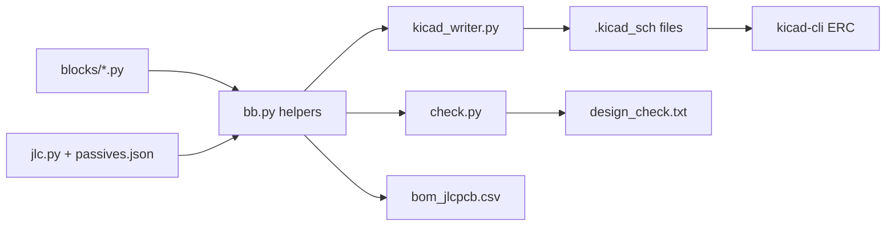

# Design flow

The schematic is not drawn by hand. It is generated from Python, so every part, value and net is code that can be reviewed, diffed and re-run. All commands below are run from the repository root. The tools use only the Python standard library.



## 1. Blocks

Each functional block is one module in `hardware/gen/blocks/`: `usbc_port` (built four times), `power_input`, `poe`, `battery`, `aux_power`, `ethernet`, `mcu`, `lora`, `audio`, `lighting`, `dc_output`, `usb_a` and `qi`. A block function receives the design object, creates a sheet and adds parts and nets. Datasheet values used for a block (resistor ratios, strap settings, capacitor minimums) are quoted in the block's docstring.

## 2. Helpers with JLCPCB data and ratings

`hardware/gen/bb.py` defines the `Design` class that blocks call: `R`, `C`, `L`, `FET`, `IC`, `LED`, `JP` (solder jumper), `TP` (test point), `RSENSE` and generic parts. Each helper pulls the chosen JLCPCB part and its ratings (`passives.json`, produced by `pick_passives.py`) and records them as part fields: LCSC number, rated voltage, rated current, and the operating current or power. `D.v(net, volts)` and `D.vp(prefix, volts)` record the worst-case voltage of nets. These fields are what the checks use.

## 3. Writing KiCad files

`hardware/gen/kicad_writer.py` writes one KiCad schematic per sheet plus a top-level sheet. It puts a **global label on every connected pin** and draws no wires, so connectivity is exactly the netlist defined in Python. A pin is marked no-connect only if the design says so; anything else left open is reported by ERC. `symlib.py` reads symbols, `generics.py` supplies passives and connectors, and `sexp.py` reads and writes the KiCad S-expression format.

```bash
python hardware/gen/build.py                   # full design
python hardware/gen/build.py --only usbc_port  # one block, for quick iteration
```

`build.py` writes the schematics, library tables, `bom_jlcpcb.csv` and `design_check.txt` into `hardware/kicad/`.

## 4. Checks

`hardware/checks/check.py` runs on every build (rules are in [design rules](design-rules.html)):

1. Voltage derating: capacitors at 2x worst-case net voltage, other parts per their rated voltage.
2. 3:1 current and power buffer on any part with operating-current or power fields.
3. Netlist sanity: every net has at least two pins, no unnamed nets, every net has a worst-case voltage.
4. BOM sanity: every BOM part has an LCSC number and enough stock for the build quantity.

`build.py` exits non-zero if any check reports an ERROR.

## 5. KiCad ERC

After generation, KiCad's own electrical rules check runs on the top-level schematic with the KiCad 10 command-line tool:

```bash
kicad-cli sch erc hardware/kicad/battery-bank.kicad_sch
```

## Picking parts

```bash
python hardware/tools/jlc.py "100nF 0402 50V"   # keyword search, top 10
python hardware/tools/jlc.py --code C1525       # look up an exact LCSC part
python hardware/tools/pick_passives.py          # re-pick passives, writes hardware/gen/passives.json
```

`jlc.py` queries the public JLCPCB parts search (network needed) and caches results in `hardware/tools/jlc_cache.json`. `pick_passives.py` picks passives whose ratings leave margin over the worst-case voltage, prefers Basic, then Preferred, then Extended parts, and requires enough stock for a small build.

Symbols, footprints and 3D models for ICs come from LCSC/EasyEDA via `easyeda2kicad` (a separate tool, not part of this repository) into `hardware/lib/`.

## Looking up datasheet values

Datasheet PDFs are listed in the [datasheet index](datasheets/INDEX.html). To search them without opening a PDF, text is extracted and then searched:

```bash
python hardware/tools/pdftxt.py docs/datasheets/BQ25756_datasheet.pdf > docs/datasheets/text/BQ25756_datasheet.txt
python hardware/tools/dsgrep.py BQ25756_datasheet "ICHG" 300 5   # <file-stem> <regex> [window] [max matches]
```

`pdftxt.py` is a dependency-free PDF text extractor. The raw text files are working data and are not published on this site. Values found this way are written into the block docstrings so each number has a traceable source.
