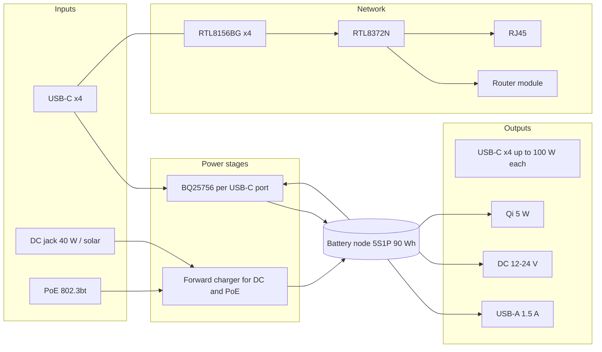

# Battery Bank / Travel Router

A 90 Wh USB-C battery bank that is also a 4-port 2.5G Ethernet dock and an OpenWrt Wi-Fi 6 travel router, with LoRa mesh, a speakerphone and open firmware.

{: .warning }
> **Design in progress. Don't build yet.** The design has not been reviewed or built. Parts, values and limits on these pages can still change. An adversarial design review must pass before layout starts.

## Highlights

- **Swappable battery cartridge:** 5S1P Samsung 50S, 90 Wh, so it flies without airline approval. Battery-only output is 125 W guaranteed.
- **Four USB-C ports:** each has its own bidirectional TI BQ25756 stage and TPS26750 PD controller, capped at 100 W per port (28 V EPR at reduced current).
- **2.5G Ethernet on all four ports:** RTL8156BG, RTL8372N switch, OpenWrt Wi-Fi 6 router module, plus an RJ45 (RTL8221B).
- **Pass-through inputs:** any USB-C port, DC barrel jack (40 W max), PoE 802.3bt Type 3 (about 51 W). Everything works at the same time from battery or pass-through.
- **Extras:** Meshtastic LoRa node, Bluetooth/IP speakerphone, flashlight and attention glow LEDs, 5 W Qi pad, NFC tap-to-pair, solar via the barrel jack, 12-24 V DC output, alarm/sunrise firmware.
- **Open firmware:** safety limits are enforced in hardware, so firmware can't exceed them.
- **Cooling:** fan plus aluminum case.

## Key specs

| Item | Value |
|---|---|
| Battery | 5S1P Samsung 50S cartridge, 90 Wh |
| Battery-only output | 125 W guaranteed |
| USB-C ports | 4, each at most 100 W |
| USB-A | 1.5 A limit (VOOC dropped; OnePlus phones use PPS) |
| Ethernet | 2.5G on all four USB-C ports, plus RJ45 |
| Pass-through inputs | USB-C, DC jack 40 W, PoE about 51 W |
| Safety policy | 3:1 buffer on current, power and thermal capacity |
| Tooling | KiCad 10, schematic generated from Python, JLCPCB part lookups |

## Block diagram

## Where to go next

- [Architecture](architecture.html): power path, networking, wireless, control bus.
- [Features](features.html): every feature and its derated limit.
- [Safety](safety.html): the 3:1 policy, battery and airline notes.
- [Manufacturing](manufacturing.html) and [Parts](parts.html).
- [Design flow](design-flow.html), [Review process](review-process.html) and [Status](status.html): how the schematic is generated and checked, and where the work stands.
- [Roadmap](roadmap.html): open decisions and risks.
- [Reference](reference.html): chip metadata, design rules, JLCPCB rules, power budget, datasheets.
