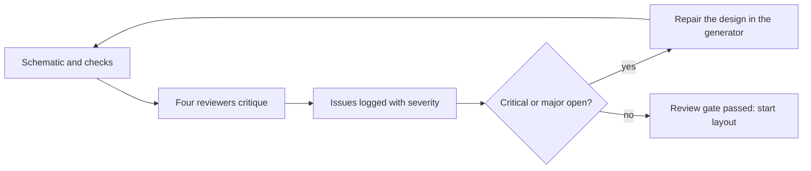

# Adversarial review process

{: .note }
> Round 1 is in progress. The first-pass schematic (main board and cartridge) is complete and the reviewers are working. Reports are written to `hardware/review/`.

Layout does not start until a review round finds no open critical or major issues. The loop:

## Reviewers

Round 1 uses four independent reviewers, each reading the schematic, [design rules](design-rules.html), [power budget](power-budget.html), [chip metadata](chip-metadata.html) and datasheets:

1. **Power and safety (Claude).** Rating violations, 3:1 buffer, protection, fusing, thermal, sequencing, the battery cartridge and its presence loop.
2. **High-speed and networking (Claude).** USB 3 and 2.5G Ethernet routing constraints, SerDes coupling, PoE, magnetics, RTL8156BG, RTL8372N and the router connector.
3. **Control, radios and DFM (Claude).** I2C map and address clashes, ESP32 strapping pins, LoRa, NFC, audio, lighting, and JLCPCB assembly and stock.
4. **Independent Codex reviewer.** An OpenAI Codex gpt-6.2-astra reviewer, run read-only through the Codex CLI so it cannot change the design. It gives a second opinion from a different model, without sharing the Claude reviewers' conclusions.

## The loop

1. **Critique.** Each reviewer tries to break the design: wrong pin functions, missing pull-ups, rating violations, I2C address clashes, power sequencing, thermal and safety gaps.
2. **Log.** Each finding is recorded in `hardware/review/` with a severity (critical, major, minor), the affected part or net and the evidence.
3. **Repair.** Fixes are made in the Python blocks, not by hand-editing generated files, then the build (`python hardware/gen/build.py`, and `--project cartridge` for the cartridge), checks and ERC are re-run.
4. **Round 2 and beyond.** Review repeats on the repaired design until no critical or major findings remain. Minor findings are either fixed or recorded as accepted. Then layout starts.

The automated checks in [Design flow](design-flow.html) catch rule violations; the review looks for design mistakes that no rule encodes. Safety is also enforced in hardware so that open firmware cannot cause harm; see [Safety](safety.html).
